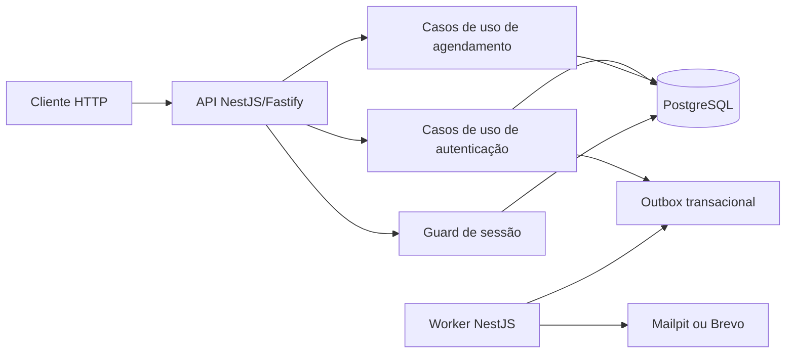

# Barber Calendar API

API multi-tenant de autenticação e agendamento da Barber Calendar. O serviço cadastra a primeira conta administradora da barbearia, autentica membros por OTP enviado por e-mail e oferece catálogo, horários e reservas de convidados.

O administrador configura serviços, profissionais, jornadas e bloqueios e acompanha o ciclo dos agendamentos. Cada barbearia tem seu fuso IANA, intervalo entre inícios e antecedência mínima.

## Sumário

- [Funcionalidades](#funcionalidades)
- [Arquitetura](#arquitetura)
- [Stack tecnológica](#stack-tecnológica)
- [Requisitos](#requisitos)
- [Início rápido com Docker](#início-rápido-com-docker)
- [Configuração](#configuração)
- [Execução sem Docker](#execução-sem-docker)
- [API](#api)
- [Banco de dados](#banco-de-dados)
- [Testes e qualidade](#testes-e-qualidade)
- [Estrutura do projeto](#estrutura-do-projeto)
- [Documentação](#documentação)
- [Contribuição](#contribuição)

## Funcionalidades

- Cadastro provisório de tenant e primeiro administrador.
- Criação definitiva de tenant, conta e vínculo somente após OTP válido.
- Login sem senha por OTP enviado exclusivamente por e-mail.
- Respostas uniformes para identidades conhecidas, desconhecidas ou inelegíveis.
- OTP de seis dígitos, uso único, validade de 10 minutos e digest HMAC-SHA-256.
- Sessões simultâneas com duração configurável entre 15 minutos e 7 dias.
- JWT RS256 com escopo de tenant e revalidação da sessão no PostgreSQL.
- Outbox transacional com envelope AES-256-GCM, retry e expurgo do payload.
- Limitação persistente por identidade e IP, inclusive entre reemissões.
- Eventos de segurança e logs estruturados com redação de dados sensíveis.
- Adapters de e-mail para Mailpit e Brevo.
- Consulta pública de catálogo e disponibilidade entre hoje e 30 dias à frente.
- Reserva de convidado com nome, telefone e e-mail, sem criar conta.
- Gestão de serviços, profissionais, jornadas semanais, pausas e folgas.
- Configurações por barbearia: intervalo padrão de 15 minutos e antecedência de 30 minutos, permitindo zero.
- Cancelamento, reagendamento e resultados `attended`/`no_show`, com histórico e estados finais imutáveis.
- Lock por tenant e exclusão GiST no PostgreSQL para integridade concorrente; mutações idempotentes por 24 horas.
- Métricas e traces via OTLP, sem dados pessoais ou IDs como labels de métricas.
- Auditoria administrativa transacional de catálogo e configurações, com consulta interna autorizada por barbearia e sem endpoint público.

## Arquitetura

O projeto é um monólito modular NestJS. Cada capacidade separa domínio, aplicação e infraestrutura; regras de lint e testes arquiteturais impedem que domínio e casos de uso dependam de NestJS, Fastify ou `pg`.



A API e o worker usam a mesma imagem OCI, mas executam como processos separados. O PostgreSQL é a autoridade transacional para desafios OTP, sessões, outbox, agenda e limites de frequência. Eventos de agenda são append-only; contatos ficam no agendamento e na resposta idempotente cifrada.

## Stack tecnológica

| Categoria              | Tecnologia                               |
| ---------------------- | ---------------------------------------- |
| Runtime                | Node.js 24                               |
| Linguagem              | TypeScript 6, ESM e modo estrito         |
| API                    | NestJS 12 com Fastify 5                  |
| Banco de dados         | PostgreSQL 18.6 com SQL explícito e `pg` |
| Validação              | Zod 4 e OpenAPI 3.1                      |
| Tokens                 | JWT RS256 com `jose`                     |
| Testes                 | Vitest 5                                 |
| Qualidade              | ESLint 10 e Prettier 3                   |
| Containers             | Docker e Docker Compose                  |
| Gerenciador de pacotes | Yarn 4.18                                |

## Requisitos

- Node.js `>=24 <25`.
- Yarn `>=4.18 <5` — o projeto fixa `yarn@4.18.1`.
- Docker com Docker Compose para PostgreSQL, Mailpit e testes E2E.

## Início rápido com Docker

Instale as dependências conforme o lockfile:

```bash
corepack enable
yarn install --immutable
```

Crie a configuração local:

```bash
cp .env.example .env
```

Substitua todos os valores `replace-with-*` e as senhas de exemplo por segredos locais. Use chaves distintas para HMAC, outbox, respostas idempotentes e JWT. Gere uma chave AES de 32 bytes em Base64 por execução do comando abaixo, separadamente para `OUTBOX_ENCRYPTION_KEY` e `IDEMPOTENCY_ENCRYPTION_KEY`:

```bash
node -e "console.log(require('node:crypto').randomBytes(32).toString('base64'))"
```

Em `JWT_PRIVATE_KEY` e `JWT_PUBLIC_KEY`, represente as quebras de linha do PEM com `\n` quando armazenar o valor em uma única linha.

Suba PostgreSQL, Mailpit, API e worker:

```bash
docker compose up --build --wait
```

Serviços locais:

| Serviço    | Endereço                       |
| ---------- | ------------------------------ |
| API        | `http://localhost:3000`        |
| Health     | `http://localhost:3000/health` |
| Readiness  | `http://localhost:3000/ready`  |
| Mailpit    | `http://localhost:8025`        |
| PostgreSQL | `localhost:5432`               |

Encerre os serviços preservando o volume do banco:

```bash
docker compose down
```

Para recriar o banco local do zero, remova também o volume. Este comando apaga os dados locais:

```bash
docker compose down -v
```

## Configuração

O processo valida as variáveis antes de aceitar tráfego. Consulte [.env.example](.env.example) para o conjunto completo.

| Variável                              | Obrigatória | Descrição                                                                                                    |
| ------------------------------------- | ----------: | ------------------------------------------------------------------------------------------------------------ |
| `DATABASE_URL`                        |         Sim | URL PostgreSQL usada pela API e pelo worker.                                                                 |
| `AUTH_SESSION_TTL`                    |         Não | Duração ISO-8601 da nova sessão; padrão `PT24H`, entre `PT15M` e `P7D`.                                      |
| `OTP_HMAC_KEY`                        |         Sim | Pepper do digest dos códigos OTP, com pelo menos 32 caracteres.                                              |
| `THROTTLE_HMAC_KEY`                   |         Sim | Chave distinta para anonimizar identidade e IP nos limites.                                                  |
| `OUTBOX_ENCRYPTION_KEY`               |         Sim | Chave AES de 32 bytes codificada em Base64.                                                                  |
| `IDEMPOTENCY_ENCRYPTION_KEY`          |         Sim | Chave AES-GCM própria de 32 bytes em Base64 para respostas idempotentes, inclusive contatos administrativos. |
| `JWT_PRIVATE_KEY`                     |         Sim | Chave privada RSA em PEM para emissão de tokens.                                                             |
| `JWT_PUBLIC_KEY`                      |         Sim | Chave pública RSA em PEM para validação de tokens.                                                           |
| `JWT_KEY_ID`                          |         Sim | Identificador `kid` da chave JWT.                                                                            |
| `JWT_ISSUER`                          |         Sim | Emissor esperado nos tokens.                                                                                 |
| `JWT_AUDIENCE`                        |         Sim | Audiência esperada nos tokens.                                                                               |
| `EMAIL_PROVIDER`                      |         Não | `mailpit` por padrão ou `brevo`.                                                                             |
| `BREVO_API_KEY`                       |  Para Brevo | Credencial da API quando `EMAIL_PROVIDER=brevo`.                                                             |
| `PORT`                                |         Não | Porta HTTP; padrão `3000`.                                                                                   |
| `TRUSTED_PROXY_CIDRS`                 |         Não | CIDRs de proxies confiáveis, separados por vírgula; vazio usa o IP da conexão.                               |
| `OTEL_EXPORTER_OTLP_TRACES_ENDPOINT`  |         Não | Endpoint HTTP OTLP para traces.                                                                              |
| `OTEL_EXPORTER_OTLP_METRICS_ENDPOINT` |         Não | Endpoint HTTP OTLP para métricas, exportadas a cada 30 segundos.                                             |

Nunca versione o arquivo `.env`, chaves privadas ou credenciais reais.

## Execução sem Docker

O banco deve estar preparado antes da API. Exporte as variáveis de ambiente e, para uma aplicação executada no host, use uma `DATABASE_URL` que aponte para `localhost`.

Desenvolvimento com recarga automática:

```bash
yarn start:dev
```

Build e execução da API:

```bash
yarn build
yarn start:prod
```

Execução do worker após o build:

```bash
yarn worker
```

## API

Os contratos OpenAPI 3.1 de [autenticação](specs/001-tenant-authentication/contracts/openapi.yaml) e [agendamento](specs/002-appointment-scheduling/contracts/openapi.yaml) são versionados separadamente. O serviço não expõe Swagger UI ou ReDoc no runtime atual.

| Método | Rota                         | Finalidade                                             |
| ------ | ---------------------------- | ------------------------------------------------------ |
| `POST` | `/v1/tenants/register`       | Iniciar cadastro provisório do tenant.                 |
| `POST` | `/v1/auth/otp-requests`      | Solicitar OTP de login.                                |
| `POST` | `/v1/auth/otp-verifications` | Verificar OTP de cadastro ou login e criar uma sessão. |
| `GET`  | `/health`                    | Verificar o processo HTTP.                             |
| `GET`  | `/ready`                     | Verificar banco e revisão compatível do schema.        |

Erros HTTP seguem Problem Details e incluem um `correlation_id`. Respostas de autenticação não revelam se e-mail, conta, tenant ou vínculo existem.

As rotas de agendamento usam `/v1/public/tenants/{tenant_slug}` e `/v1/management`. Todas as rotas de gestão exigem Bearer JWT, sessão ativa e papel `administrator`; o tenant é derivado da sessão. Toda mutação exige `Idempotency-Key` de 16–128 caracteres: a mesma chave, ator, operação, recurso e corpo reproduzem a resposta original por 24 horas; outro corpo retorna 409.

| Método        | Rota                                                                       | Finalidade                                                            |
| ------------- | -------------------------------------------------------------------------- | --------------------------------------------------------------------- |
| `GET`         | `/v1/public/tenants/{tenant_slug}/services`                                | Serviços ativos e profissionais elegíveis.                            |
| `GET`         | `/v1/public/tenants/{tenant_slug}/availability`                            | Horários por `service_id`, `date` local e `professional_id` opcional. |
| `POST`        | `/v1/public/tenants/{tenant_slug}/appointments`                            | Reserva de convidado.                                                 |
| `GET`, `PUT`  | `/v1/management/scheduling-settings`                                       | Intervalo e antecedência mínima.                                      |
| `GET`, `PUT`  | `/v1/management/time-zone`                                                 | Fuso IANA da barbearia.                                               |
| `GET`, `POST` | `/v1/management/services`                                                  | Catálogo administrativo.                                              |
| `PATCH`       | `/v1/management/services/{service_id}`                                     | Alteração, associações e desativação.                                 |
| `GET`, `POST` | `/v1/management/professionals`                                             | Profissionais da barbearia.                                           |
| `PATCH`       | `/v1/management/professionals/{professional_id}`                           | Alteração e desativação.                                              |
| `GET`, `PUT`  | `/v1/management/professionals/{professional_id}/weekly-periods`            | Consulta e substituição completa da jornada.                          |
| `GET`, `POST` | `/v1/management/professionals/{professional_id}/exceptions`                | Consulta por período e criação de bloqueios.                          |
| `DELETE`      | `/v1/management/professionals/{professional_id}/exceptions/{exception_id}` | Remoção de bloqueio.                                                  |
| `GET`         | `/v1/management/appointments`                                              | Agenda por período, profissional e estado.                            |
| `POST`        | `/v1/management/appointments/{appointment_id}/cancellation`                | Cancelar e liberar intervalo após commit.                             |
| `POST`        | `/v1/management/appointments/{appointment_id}/rescheduling`                | Reagendar preservando serviço, profissional e snapshots.              |
| `POST`        | `/v1/management/appointments/{appointment_id}/outcome`                     | Registrar atendimento ou não comparecimento.                          |

Mudanças de capacidade conflitantes retornam 409 e IDs de compromissos apenas do tenant autorizado, sem contatos. A gestão aceita o ID retornado pela agenda/conflito ou pela confirmação pública, usando o mesmo escopo idempotente. Estados `cancelled`, `attended` e `no_show` são finais; `no_show` exige o início agendado e `attended` exige o término. Consulte os [exemplos de consumo e validação](specs/002-appointment-scheduling/quickstart.md).

Limites públicos iniciais: 120 leituras e 10 tentativas de reserva por minuto, tenant e HMAC do IP, incluindo replay. Respostas 429 incluem `Retry-After`. O IP bruto e a chave idempotente não são persistidos.

## Banco de dados

O schema não é criado por ORM, migration runner ou startup da aplicação. A fonte canônica são os scripts em `database/schema/`, executados em ordem por `database/init/00-bootstrap.sql` quando o container PostgreSQL inicia com armazenamento vazio.

Alterações em bancos persistentes usam scripts manuais em:

```text
database/releases/<release>/up.sql
database/releases/<release>/verify.sql
database/releases/<release>/rollback.sql
```

O usuário `barber_runtime` possui somente os privilégios DML necessários. A revisão suportada fica em `app_meta.schema_build` e é conferida pelo endpoint `/ready`.

A revisão atual é `002-appointment-scheduling-v2`. O release original em `database/releases/002-appointment-scheduling/` leva autenticação v3 a agendamento v1. O incremento em `database/releases/002-appointment-scheduling-audit/` exige v1 e acrescenta auditoria/RLS em v2. Em cada etapa aplicar `up.sql` e executar `verify.sql` antes de iniciar a aplicação correspondente; não há atualização automática.

Suspender escritas durante a troca de revisão. O rollback incremental retorna a v1 e preserva a agenda, mas remove definitivamente eventos administrativos e concessões: preservar uma exportação protegida antes, quando necessário. O rollback original v1 → autenticação remove todo o schema de agendamento e seus dados; `btree_gist` permanece instalado. Ensaiar reversões em cópia descartável.

Para ensaiar aplicação, verificação, rollback e reaplicação contra o bootstrap atual, com o commit anterior `4bf8c9d` disponível no histórico Git:

```bash
sh scripts/check-scheduling-release.sh
```

O script cria PostgreSQL descartável na porta 55434, não usa `DATABASE_URL` e compara catálogos, grants, RLS e revisão, além de conferir a preservação de dados v1 no incremento e no seu rollback. `BARBER_BASELINE_REF` permite indicar outra referência equivalente de autenticação; `RELEASE_DB_PORT` altera a porta do ensaio.

Valide o bootstrap, grants, constraints e índices:

```bash
docker compose -f compose.e2e.yaml up -d --wait db-e2e
docker compose -f compose.e2e.yaml exec -T db-e2e \
  psql -v ON_ERROR_STOP=1 -U postgres -d barber_calendar_e2e \
  -f /opt/app-sql/verify/assertions.sql
docker compose -f compose.e2e.yaml down -v --remove-orphans
```

### Consulta interna da auditoria

O runtime só insere em `scheduling.configuration_events`; suporte usa login PostgreSQL individual, separado do runtime/owner e sem privilégios elevados, membro de `barber_audit_reader`. A operação concede acesso temporário por tenant em `scheduling.configuration_audit_access`. RLS verifica o login original (`session_user`), mesmo sem filtro SQL; suporte não concede acesso a si próprio nem altera eventos. Não há endpoint HTTP de auditoria. Na trilha, `name`, `display_name`, `description` e `reason` são sempre redigidos integralmente; a mudança permanece identificada e valores estruturados anteriores/novos continuam disponíveis. Essa proteção não depende de reconhecer o formato de uma credencial.

Com `psql` e credenciais operacionais de leitura fornecidas fora da linha de comando, executar na raiz:

```bash
psql -X -v audit_tenant_id='uuid-da-barbearia-autorizada' \
  -v audit_from='2030-01-07T00:00:00Z' \
  -v audit_before='2030-01-08T00:00:00Z' \
  -f database/operations/query-configuration-audit.sql
```

O UUID deve ser real no ambiente de consulta. O script valida período, filtros, cursor e limite de 1–100 registros; resultados seguem instante/ID. Concessão expirada/revogada impede novas consultas; revogação imediata pode exigir encerramento operacional das sessões já em execução. Remover concessões antes de reutilizar um login. Detalhes de concessão/revogação e validação estão no [guia da funcionalidade](specs/002-appointment-scheduling/quickstart.md). A auditoria começa na ativação v2, sem reconstruir alterações anteriores; não expira com a idempotência de 24 horas.

## Testes e qualidade

Os testes da consulta operacional também exigem o cliente `psql` disponível no PATH; PostgreSQL continua executado em container descartável.

| Comando                                  | Verificação                                                                  |
| ---------------------------------------- | ---------------------------------------------------------------------------- |
| `yarn lint`                              | ESLint, ciclos e fronteiras arquiteturais.                                   |
| `yarn typecheck`                         | TypeScript estrito sem emissão.                                              |
| `yarn build`                             | Build NestJS de produção.                                                    |
| `yarn test:unit`                         | Testes unitários e arquiteturais.                                            |
| `yarn test:contract`                     | Compatibilidade com o contrato OpenAPI.                                      |
| `yarn test:integration`                  | Integração com PostgreSQL indicado por `DATABASE_URL`.                       |
| `yarn test:e2e`                          | Ambiente PostgreSQL/Mailpit descartável, integração e E2E seriais.           |
| `yarn contract:check`                    | Estrutura obrigatória do OpenAPI 3.1.                                        |
| `yarn schema:check`                      | Bootstrap vazio e comparação do snapshot estrutural.                         |
| `yarn ci:check`                          | Lint, tipos, build, unitários, contratos, OpenAPI, schema, integração e E2E. |
| `sh scripts/check-scheduling-release.sh` | Ensaio SQL de upgrade, reversão e equivalência em banco descartável.         |

Os testes E2E usam `compose.e2e.yaml`, armazenamento `tmpfs` e teardown com remoção de volumes mesmo quando a suíte falha.

Para executar `yarn test:unit` isoladamente, rode `yarn build` antes: os testes de aliases também importam o JavaScript compilado pelo Node. `yarn ci:check` sempre produz um build novo. A integração isolada exige banco de testes preparado e credenciais administrativas para reset; prefira `yarn test:e2e` para provisionar esse ambiente automaticamente.

O histograma `scheduling_request_duration_seconds` permite calcular p95 no coletor OTLP. Contadores `scheduling_conflict`, `scheduling_transition`, `scheduling_replay` e `scheduling_throttled` usam somente categorias fixas de operação/resultado. O diagnóstico local usa buckets fixos para estimar p95, sem reter amostras. Não há SLA de latência definido nem endpoint `/metrics` nesta API.

Falhas de inicialização, erros HTTP 5xx e falhas propagadas no ciclo do worker geram diagnóstico JSON com etapa, stack trace e cadeia de causas sanitizadas. Variáveis inválidas são identificadas pelo nome; erros de schema informam revisões esperada/encontrada. As respostas HTTP não expõem stacks. Os comandos de produção e o container habilitam source maps para localizar a falha no TypeScript. Consulte o [guia de diagnóstico de erros](docs/error-diagnostics.md) para interpretar os campos, códigos e limites de privacidade.

O Husky instala `.husky/pre-commit` durante `yarn install`. Antes de cada commit, o hook executa `yarn ci:check`, incluindo as suítes que dependem de Docker.

## Estrutura do projeto

```text
.
├── src/
│   ├── modules/
│   │   ├── authentication/
│   │   ├── notifications/
│   │   ├── outbox/
│   │   ├── scheduling/
│   │   └── tenancy/
│   ├── shared/
│   ├── main.ts
│   └── worker.ts
├── database/
│   ├── init/
│   ├── schema/
│   ├── releases/
│   ├── seeds/
│   └── verify/
├── test/
│   ├── unit/
│   ├── integration/
│   ├── contract/
│   ├── e2e/
│   └── architecture/
├── specs/001-tenant-authentication/
├── specs/002-appointment-scheduling/
├── docs/
├── compose.yaml
└── compose.e2e.yaml
```

## Documentação

- [Especificação funcional](specs/001-tenant-authentication/spec.md)
- [Plano de implementação](specs/001-tenant-authentication/plan.md)
- [Modelo de dados](specs/001-tenant-authentication/data-model.md)
- [Decisões técnicas](specs/001-tenant-authentication/research.md)
- [Guia de validação](specs/001-tenant-authentication/quickstart.md)
- [Contrato OpenAPI](specs/001-tenant-authentication/contracts/openapi.yaml)
- [Especificação de agendamento](specs/002-appointment-scheduling/spec.md)
- [Contrato de agendamento](specs/002-appointment-scheduling/contracts/openapi.yaml)
- [Validação e evidências de agendamento](specs/002-appointment-scheduling/quickstart.md)
- [Implantação](docs/deployment.md)

## Contribuição

Antes de enviar uma alteração, execute os testes proporcionais ao risco, lint e type checking. Mudanças estruturais no PostgreSQL devem seguir o checklist de [CONTRIBUTING.md](CONTRIBUTING.md), incluindo scripts explícitos de aplicação, verificação e rollback.

## Licença

Este é um software proprietário e confidencial. Nenhuma permissão de uso, cópia, modificação, distribuição ou exploração comercial é concedida sem autorização prévia e escrita do titular. Consulte a [LICENSE](LICENSE). Componentes de terceiros permanecem sujeitos às suas próprias licenças.
